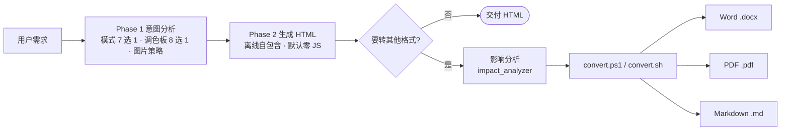
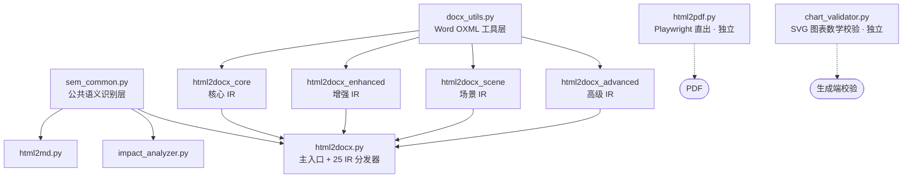

# html-generator-skills

**一次内容编排 · 四种格式输出（HTML / Word / PDF / Markdown）**

面向 AI 智能体的 HTML 文档生成与转换技能集。说一句"帮我生成一份调研报告"，得到一份视觉精良、离线自包含的 HTML；需要时一键转 Word / PDF / Markdown。

本仓库包含两个技能：

| 技能 | 用途 |
|---|---|
| **html-generator** | 通用 HTML 文档生成 + 四格式转换（本 README 主体） |
| **knowledge-handbook-builder** | 深度调研领域并沉淀为带图示的 HTML 知识手册（模板挂语义 class，可复用 html-generator 的转换管线） |

---

## 概念图 1 · 工作流



**核心理念：生成放开、转换归约。** 生成端不设固定块模板（视觉自由设计）；转换端靠轻量语义 class 把自由 HTML 归约到 25 种 IR 语义，再映射到各格式。HTML 是源文件，其余是派生格式。

---

## 概念图 2 · 转换架构



四层拆分 + 公共语义层：一份语义识别逻辑，三份转换脚本（docx / md / impact）共用，改一处即全局生效。

---

## 概念图 3 · 语义 class → IR → 三格式

<svg viewBox="0 0 680 320" width="680" height="320" xmlns="http://www.w3.org/2000/svg" role="img" aria-label="语义 class 到 IR 再到三种输出格式的归约管道">
  <rect x="0" y="0" width="680" height="320" fill="#f4f7fb"/>
  <text x="340" y="24" text-anchor="middle" font-size="14" font-weight="bold" fill="#0f1e33" font-family="sans-serif">生成放开 · 转换归约</text>

  <rect x="16" y="44" width="150" height="252" rx="10" fill="#ffffff" stroke="#dbe4ef"/>
  <text x="91" y="66" text-anchor="middle" font-size="12" font-weight="bold" fill="#0f1e33" font-family="sans-serif">语义 class（12+2）</text>
  <g font-family="monospace" font-size="11" fill="#1f2d3d">
    <rect x="30" y="78" width="122" height="22" rx="4" fill="#e8f0fe"/><text x="38" y="93">title</text>
    <rect x="30" y="106" width="122" height="22" rx="4" fill="#e8f0fe"/><text x="38" y="121">heading / paragraph</text>
    <rect x="30" y="134" width="122" height="22" rx="4" fill="#e8f0fe"/><text x="38" y="149">card / stat</text>
    <rect x="30" y="162" width="122" height="22" rx="4" fill="#e8f0fe"/><text x="38" y="177">table / timeline</text>
    <rect x="30" y="190" width="122" height="22" rx="4" fill="#e8f0fe"/><text x="38" y="205">code / callout</text>
    <rect x="30" y="218" width="122" height="22" rx="4" fill="#e8f0fe"/><text x="38" y="233">image / list</text>
    <rect x="30" y="246" width="122" height="22" rx="4" fill="#e8f0fe"/><text x="38" y="261">end_page</text>
    <rect x="30" y="274" width="122" height="22" rx="4" fill="#c9d6f3"/><text x="38" y="289">cite / source-list</text>
  </g>

  <path d="M170 170 L 208 170" stroke="#3b82f6" stroke-width="2" fill="none"/>
  <polygon points="208,170 200,165 200,175" fill="#3b82f6"/>

  <rect x="214" y="44" width="176" height="252" rx="10" fill="#ffffff" stroke="#dbe4ef"/>
  <text x="302" y="66" text-anchor="middle" font-size="12" font-weight="bold" fill="#0f1e33" font-family="sans-serif">25 种 IR 语义</text>
  <circle cx="302" cy="150" r="52" fill="none" stroke="#3b82f6" stroke-width="2"/>
  <text x="302" y="146" text-anchor="middle" font-size="20" font-weight="bold" fill="#3b82f6" font-family="sans-serif">25</text>
  <text x="302" y="166" text-anchor="middle" font-size="11" fill="#5b6b80" font-family="sans-serif">IR 语义</text>
  <text x="302" y="222" text-anchor="middle" font-size="11" fill="#5b6b80" font-family="sans-serif">结构特征兜底识别</text>
  <text x="302" y="240" text-anchor="middle" font-size="11" fill="#5b6b80" font-family="sans-serif">blockquote → quote</text>
  <text x="302" y="258" text-anchor="middle" font-size="11" fill="#5b6b80" font-family="sans-serif">details → faq</text>
  <text x="302" y="276" text-anchor="middle" font-size="11" fill="#5b6b80" font-family="sans-serif">svg/canvas → chart</text>

  <path d="M394 170 L 432 170" stroke="#3b82f6" stroke-width="2" fill="none"/>
  <polygon points="432,170 424,165 424,175" fill="#3b82f6"/>

  <rect x="438" y="44" width="226" height="252" rx="10" fill="#ffffff" stroke="#dbe4ef"/>
  <text x="551" y="66" text-anchor="middle" font-size="12" font-weight="bold" fill="#0f1e33" font-family="sans-serif">派生格式</text>

  <rect x="454" y="82" width="194" height="58" rx="8" fill="#e8f0fe" stroke="#3b82f6"/>
  <text x="551" y="104" text-anchor="middle" font-size="13" font-weight="bold" fill="#0f1e33" font-family="sans-serif">Word .docx</text>
  <text x="551" y="124" text-anchor="middle" font-size="11" fill="#5b6b80" font-family="sans-serif">语义 95% · 视觉 70%</text>

  <rect x="454" y="150" width="194" height="58" rx="8" fill="#e8f0fe" stroke="#3b82f6"/>
  <text x="551" y="172" text-anchor="middle" font-size="13" font-weight="bold" fill="#0f1e33" font-family="sans-serif">PDF .pdf</text>
  <text x="551" y="192" text-anchor="middle" font-size="11" fill="#5b6b80" font-family="sans-serif">语义 95% · 视觉 95%</text>

  <rect x="454" y="218" width="194" height="58" rx="8" fill="#e8f0fe" stroke="#3b82f6"/>
  <text x="551" y="240" text-anchor="middle" font-size="13" font-weight="bold" fill="#0f1e33" font-family="sans-serif">Markdown .md</text>
  <text x="551" y="260" text-anchor="middle" font-size="11" fill="#5b6b80" font-family="sans-serif">结构保真 · 视觉不保留</text>
</svg>

---

## 快速开始

```bash
# 方式 A：整仓克隆
git clone https://github.com/Asaceoo/html-generator-skills.git

# 方式 B：只装 html-generator —— 下载 Release 附件 html-generator-vX.Y.Z.zip，
# 解压为 html-generator/ 放入技能目录（如 ~/.workbuddy/skills/）
```

生成（对话里直接说）：

> 帮我生成一份《2026 年智能家居行业调研报告》
> 用对比模式，配色用深蓝金，转 Word

转换：

```bash
# Windows
powershell -File html-generator/scripts/win/convert.ps1 -Format docx -InputFile 报告.html -OutputFile 报告.docx -Yes
# macOS / Linux
bash html-generator/scripts/unix/convert.sh --format pdf --input 报告.html --output 报告.pdf --yes
# 先看会掉什么（影响分析）
python html-generator/scripts/impact_analyzer.py 报告.html --format docx --json
# SVG 图表数学校验
python html-generator/scripts/chart_validator.py 报告.html
```

给任意 AI 智能体接入：让它读取 `html-generator/SKILL.md`（三阶段工作流）或 `knowledge-handbook-builder/AGENT.md`（三种接入方式）。

---

## 能力速览

| 维度 | 内容 |
|---|---|
| 文档模式 | 7 种：doc / compare / status / explainer / dashboard / deck / auto |
| 调色板 | 8 组 × 20 语义色位：墨蓝 · 暖金 · 青绿 · 玫红 · 深蓝金 · 紫韵 · 橙韵 · 灰调 |
| 语义 class | 12 种块级 + cite / source-list 2 种辅助 |
| IR 语义 | 25 种，Word / PDF / Markdown 三向映射 |
| 输出约束 | 离线自包含（无外链 CSS / JS / 图片 / 字体），默认零 JS |
| 图片 | base64 内嵌，自动压缩至 200KB 以下，`data-float` 标注布局 |
| 图表 | SVG 坐标程序计算 + chart_validator 数学校验 + 转 Word 截图 / 数据重建双路径 |
| 交互 | 用户明确要求时启用（Tab / 折叠 / 搜索 / 复制 / 返回顶部），JS ≤ ~2KB |
| 保真度 | Word 语义 95% 视觉 70% · PDF 语义 95% 视觉 95% · Markdown 语义 90% |

---

## 仓库结构

```
html-generator-skills/
├── VERSION                          # 版本号唯一来源
├── CHANGELOG.md
├── README.md                        # 本文件
├── docs/
│   ├── 用户手册_vX.Y.Z.md
│   ├── 技术手册_vX.Y.Z.md
│   └── archive/                     # 历史版本手册
├── scripts/
│   └── release.py                   # 版本递增 + 手册同步 + 技能打包
├── html-generator/                  # 技能本体（SKILL.md / references / scripts）
├── knowledge-handbook-builder/      # 知识手册构建技能
├── tests/                           # 自动化测试
└── .github/workflows/ci.yml         # CI：pytest + 资产校验 + SKILL.md frontmatter
```

---

## 文档

| 文档 | 读者 | 说明 |
|---|---|---|
| `docs/用户手册_v1.9.1.md` | 使用者 / AI 智能体 | 场景、命令、模式与配色、降级说明、FAQ |
| `docs/技术手册_v1.9.1.md` | 开发者 / 维护者 | 架构、语义识别、校验机制、修改指南、回归清单 |
| `html-generator/SKILL.md` | AI 智能体 | 三阶段工作流与生成规则（技能入口） |
| `CHANGELOG.md` | 全部 | 版本历史（semver） |

历史版本手册保留在 `docs/archive/`。

---

## 版本与发布

版本号唯一来源是仓库根 `VERSION`，两份手册的文件名与正文版本号随它同步。

```bash
python scripts/release.py --part minor   # patch（默认）/ minor / major
```

执行链：递增版本号 → 同步两个技能的 VERSION → 旧手册归档 `docs/archive/` → 生成新版手册（文件名 + 正文版本号同步）→ 打包 `dist/html-generator-v{版本}.zip`（排除 `__pycache__` / `.pyc` / `dist`）。zip 可直接作为 Release 附件，解压即得完整技能目录。

---

## 环境要求

- Python 3.9+（转换脚本）；首次运行由入口脚本自动准备环境（conda env `html-convert` 优先，失败自动回退 venv `~/.html-convert-env`）
- 依赖：`python-docx`、`beautifulsoup4`、`lxml`、`playwright`（Chromium 约 100MB，首次自动下载）
- 可选：`pymupdf`（PDF 尾页空白检测）、`cssutils`（`<style>` 预解析），缺失自动降级
- 生成 HTML 阶段零依赖、完全离线

---

## License

MIT — 见 [LICENSE](LICENSE)。
