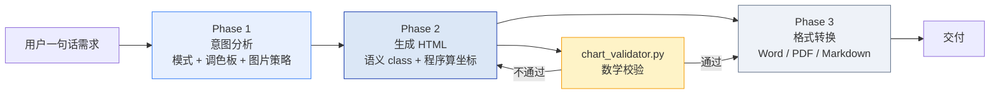
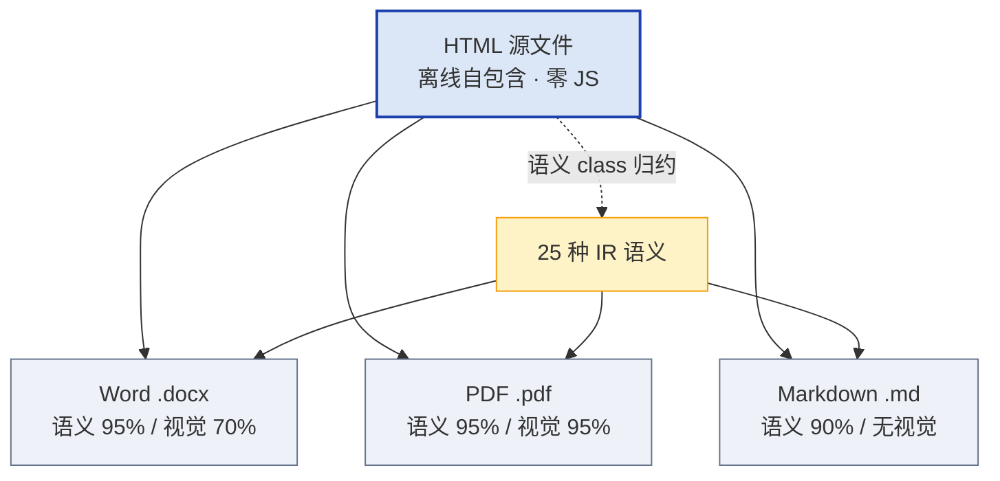
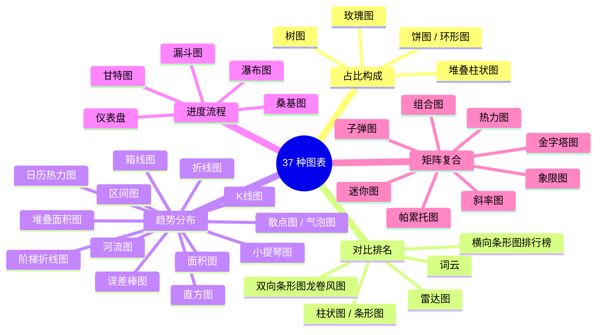
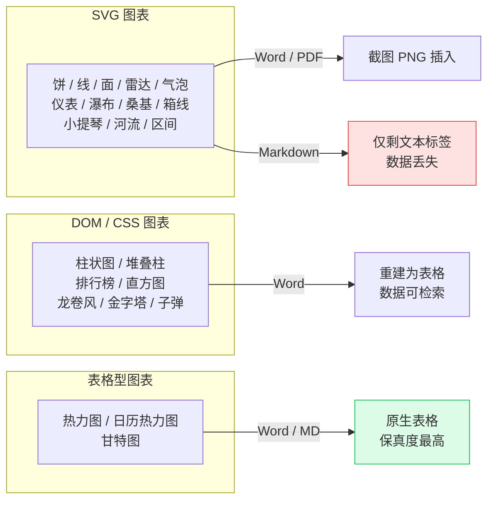

# html-generator

**一次内容编排 · 四种格式输出（HTML / Word / PDF / Markdown）**

> 版本 **v1.13.1** · 37 种图表 · 7 种文档模式 · 8 组调色板 · 25 种 IR 语义

通用 HTML 文档生成技能：你说一句"写份 XX 报告"，它产出一个视觉精良、离线自包含的 HTML；需要时一键转成 Word / PDF / Markdown。

---

## 核心理念

**生成放开、转换归约。**

- **生成端不设固定块模板**：LLM 自由设计 HTML 结构与视觉样式，只在关键结构外层挂 12 种轻量语义 class。
- **转换端靠语义归约**：通过语义 class + 结构特征，把自由 HTML 归约到 25 种 IR 语义，再映射到 Word / PDF / Markdown。

HTML 是源文件，其余三种是派生格式——**以 HTML 为准，转换是尽力而为的语义归约**。

---

## 概念图

### 1. 三阶段工作流



### 2. 一次编排，四种输出



### 3. 图表能力全景（37 种）



### 4. 转换降级路径



---

## 安装

技能目录放到 WorkBuddy 的 skills 目录下即可（用户级 `~/.workbuddy/skills/`，项目级 `{workspace}/.workbuddy/skills/`）：

```
~/.workbuddy/skills/html-generator/
```

首次运行转换脚本时会自动创建 Python 虚拟环境并安装依赖（含 Playwright Chromium），无需手动干预。

---

## 用法

### 三种触发方式

| 方式 | 说明 | 示例 |
|---|---|---|
| **自然语言** | 直接说需求，技能自动判断模式与配色 | `写一份 Q3 渠道运营报告` |
| **显式指定** | 在需求里点名模式 / 调色板 / 图片 | `用紫韵色做一份 dashboard` |
| **格式转换** | 已有 HTML，要求导出其它格式 | `把这份报告转成 Word` |

### 常用触发词

`生成HTML` `写文档` `做方案` `做报告` `生成页面` `做个页面` `生成网页` `写个HTML` `做个HTML` `转Word` `转PDF` `转Markdown` `导出文档`

---

## 使用说明

### 文档模式（7 种，自动选择，可显式覆盖）

| 模式 | 适用 | 结构特征 |
|---|---|---|
| `mode-doc` | 技术方案、调研报告、通用文档 | 标题 → 正文 → 小节 |
| `mode-compare` | 方案对比、产品选型 | 多列并排卡片，推荐项高亮 |
| `mode-status` | 项目周报、进度汇报、事故报告 | 状态胶囊 + 时间线 + 指标数字 |
| `mode-explainer` | 教程、使用指南、概念讲解 | 正文 + 可折叠深挖 + 代码块 |
| `mode-dashboard` | 数据概览、经营简报 | 大数字指标 + 迷你图 + 表格 |
| `mode-deck` | 品牌长页、活动专题、年度回顾 | 整屏滚动吸附 + Hero 渐变 |
| `mode-auto` | 无匹配时自由发挥 | 精简骨架，自由填组件 |

### 调色板（8 组，自动匹配，可显式覆盖）

| 调色板 | 适用 |
|---|---|
| 墨蓝 `ink-blue` | 技术、数据、项目、系统、架构 |
| 暖金 `warm-gold` | 活动、旅行、生活、人文 |
| 青绿 `teal` | 教育、健康、环保 |
| 玫红 `rose` | 营销、创意、社交 |
| 深蓝金 `navy-gold` | 简历、年报、商务、提案 |
| 紫韵 `violet` | 设计、艺术、时尚、文化 |
| 橙韵 `orange` | 运动、餐饮、社群 |
| 灰调 `mono` | 简历、学术、技术文档、极简 |

每组提供 20 个语义色位（`--c-primary` / `--c-accent` / `--c-bg` …），生成时用 `palettes.json` 中的精确色值。

### 语义 class（12 种块级 + 2 种辅助）

只需在**关键结构最外层**加一个 class，视觉样式完全自由：

`title` `heading` `paragraph` `card` `table` `timeline` `stat` `code` `callout` `image` `list` `end_page`
+ 辅助：`cite`（正文引用标记）、`source-list`（数据来源列表，需与 cite 配对）

可选 `data-*`：`data-level`（标题层级）、`data-variant`（callout 变体）、`data-cols`（列数）、`data-lang`（代码语言）、`data-caption`（表/图标题）、`data-float`（图片位置）

### 图片策略

**默认不加图。** 仅当你明确要求配图、提供本地图片或指定 URL 时才插入，且一律 base64 内嵌（离线自包含），自动压缩到 200KB 以下。

### 图表强制规范

1. SVG 坐标**必须用 Python 计算**，禁止手写 `path` 的 `d` 属性
2. 生成后**必须运行** `python scripts/chart_validator.py {文件}` 校验
3. 校验通过后**必须截图 + 视觉核对**
4. 带 `data-chart="..."` 的类型必须正确打标（22 种标记，否则会被旧校验器误判）

---

## 20 个使用实例

### 文档生成（1–8）

**1. 技术方案文档**
```
写一份「门店数字化改造技术方案」，含架构分层、实施步骤、风险清单
```
→ 自动选 `mode-doc` + 墨蓝

**2. 方案对比**
```
对比 Tauri / Electron / WPF 三种桌面方案，从包体积、启动速度、生态、维护成本四个维度
```
→ 自动选 `mode-compare`

**3. 项目周报**
```
生成第 42 周项目周报：3 项已完成、2 项进行中、1 项受阻，附下周计划
```
→ 自动选 `mode-status`

**4. 新手教程**
```
写一份 CapsWriter 离线语音听写的安装配置教程，含常见问题
```
→ 自动选 `mode-explainer`

**5. 数据简报**
```
做一份 10 月经营简报：GMV 2314 万、订单 4.2 万、客单价 551 元，环比 +9.2%
```
→ 自动选 `mode-dashboard`

**6. 品牌长页**
```
做一个「春秋门业」产品介绍长页，整屏滚动，含产品系列与案例
```
→ 自动选 `mode-deck`

**7. 年度回顾**
```
生成 2026 年度回顾专题页，按季度梳理大事记
```
→ 自动选 `mode-deck`

**8. 单页简历**
```
基于我的经历生成一页 A4 简历，深蓝金配色
```
→ 自动选 `mode-doc` + `navy-gold`

### 格式转换（9–12）

**9. 转 Word**
```
把这份报告转成 Word
```
**10. 转 PDF**
```
转成 PDF
```
**11. 转 Markdown**
```
导出 Markdown
```
**12. 一次转三种**
```
同时导出 Word、PDF 和 Markdown
```

> 转换前会先做影响分析，列出降级项（如卡片→表格、SVG→PNG）并等你确认。

### 样式与交互控制（13–16）

**13. 指定调色板**
```
用紫韵色重新生成这份方案
```
**14. 指定模式**
```
改用 dashboard 模式呈现这些数据
```
**15. 加交互**
```
给这份文档加上 Tab 切换和可折叠的深挖区块
```
**16. 加配图**
```
给每个章节配一张 AI 生成的插图
```

### 图表专项（17–20）

**17. 占比 + 趋势组合**
```
做一份渠道分析，用饼图看 GMV 占比，用折线图看 6 个月趋势
```
**18. 转化漏斗 + 热力图**
```
分析用户转化：漏斗图看各级流失，热力图看各渠道 × 各月份的转化率
```
**19. 项目排期甘特图**
```
生成 2027 年度产品路线图甘特图，按季度合并，不超过 8 列
```
**20. 敏感性分析**
```
做利润敏感性分析，用龙卷风图展示各因素的正负影响
```

---

## 转换保真度

| 格式 | 语义保真 | 视觉保真 | 说明 |
|---|---|---|---|
| HTML → Word | 95% | 70% | 内容完整；卡片/时间线降级为表格/段落；SVG 图表截图插入 |
| HTML → PDF | 95% | 95% | 近乎 1:1；仅交互动画不可静态呈现 |
| HTML → Markdown | 90% | — | 保留标题/列表/表格/代码块；**SVG 图表数据会丢失** |

> ⚠️ 转 Markdown 时所有 SVG 图表只剩文本标签。若需要保留图表，请用 HTML / Word / PDF。

---

## 目录结构

```
html-generator/
├── SKILL.md                      # 技能主文档（LLM 执行流程）
├── README.md                     # 本文件
├── VERSION                       # 版本号
├── 用户手册_vX.Y.Z.md            # 用户手册（面向使用者）
├── 技术手册_vX.Y.Z.md            # 技术手册（面向维护者）
├── references/
│   ├── semantic-classes.md       # 12+2 语义 class 定义（生成端必读）
│   ├── palettes.json             # 8 组调色板 × 20 语义色位
│   ├── design-system.md          # 字体/字号/间距/图表组件规范
│   ├── chart-guide.md            # 37 种图表公式 + 模板（含图表时必读）
│   ├── ir-blocks.md              # 25 种 IR 语义字典
│   ├── interactive-pack.md       # 交互增强组件
│   ├── large-html-iterative-editing.md
│   └── skeletons/mode-*.html     # 7 种模式骨架
└── scripts/
    ├── chart_validator.py        # 图表数学校验（只读）
    ├── selfcheck.py              # 发布前自检清单（只读）
    ├── build_release.py          # 打包脚本（自动递增版本号）
    ├── impact_analyzer.py        # 转换前影响分析
    ├── html2docx.py / html2md.py / html2pdf.py
    ├── sem_common.py             # 公共语义识别层
    └── win/convert.ps1 · unix/convert.sh
```

---

## 维护命令

```bash
# 图表校验（生成含图表的 HTML 后必跑）
python scripts/chart_validator.py 报告.html --json

# 发布前自检（清单约束兜底）
python scripts/selfcheck.py

# 打包发布（自动递增版本号 + 同步手册版本号 + 打 zip）
python scripts/build_release.py --bump patch
```

---

## 许可证

MIT
